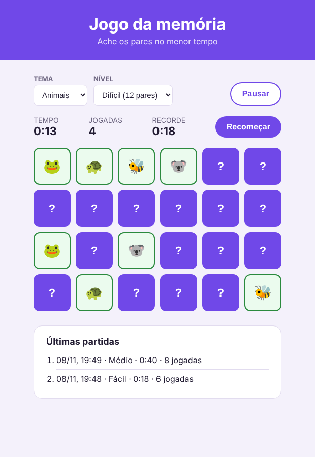

# Jogo da memória: separando em módulos

O jogo da memória já funciona inteiro: três temas, três níveis, cronômetro
com pausa, recorde e o histórico das últimas partidas. Mas todo o
JavaScript está num arquivo só, o `src/main.js`, com umas **400 linhas**, e
tudo misturado: uma variável do cronômetro, depois uma função da tela, depois
uma regra do jogo, depois um `querySelector`...

A sua tarefa é a mesma que fizemos com o quiz: **separar o arquivo em
módulos**, sem mudar o que o jogo faz. Desta vez, o código não vem separado
em partes: você vai procurar cada coisa e decidir para onde ela vai.

---

## Antes de começar

1. Copie a pasta `memoria-ponto-de-partida`.
2. No terminal, dentro da pasta:

   ```
   npm install
   npm run dev
   ```

3. Abra o endereço que aparecer e jogue uma partida. Teste tudo: troque o
   tema e o nível, pause, continue, termine a partida e veja o histórico.



---

## Os módulos que o projeto vai ter

Todos dentro da pasta `src/`:

| arquivo | a responsabilidade dele |
|---|---|
| `cartas.js` | os dados: os símbolos de cada tema |
| `jogo.js` | as regras do jogo: embaralhar, sortear os símbolos, montar o baralho, conferir um par, saber se acabou |
| `recorde.js` | o menor tempo, guardado no `localStorage` |
| `historico.js` | as últimas partidas, guardadas no `localStorage` |
| `cronometro.js` | o tempo da partida: começar, parar, pausar, continuar e mostrar `1:05` |
| `tela.js` | tudo o que mexe na página |
| `main.js` | o que sobra: o estado da partida, as funções da partida e os cliques |

O `main.js` já existe: é o arquivo grande. No fim, ele fica só com a última
linha da tabela.

**O jeito de mover cada coisa** (vale para todos os passos):

1. Ache o item com o **Ctrl+F**.
2. **Recorte** (Ctrl+X) e cole no arquivo novo. Recortar, e não copiar: se
   o código ficar nos dois arquivos, o console reclama
   (`has already been declared`).
3. Coloque `export` só no que outro arquivo usa. O resto fica escondido.
4. No começo do `main.js`, faça o `import` do que ele usa.
5. Faça **o teste de sempre** (logo abaixo) e olhe o console.

**O teste de sempre:** jogue uma partida no Fácil, pausando e continuando no
meio, até o fim. Depois, troque o tema e o nível. O jogo tem que funcionar
igual, e o console não pode mostrar nenhum erro vermelho.

> Por que testar tudo? Quase todas as funções só rodam quando alguém clica.
> Se faltou um `import`, o erro `... is not defined` só aparece na hora em
> que aquela função é chamada.

---

## Passo 1 — `cartas.js`

Comece pelo mais fácil: os dados. Mova para o `cartas.js` o objeto `temas`,
com os três temas.

**Funcionou se:** o teste de sempre funciona, e o `main.js` tem um `import`
no começo.

---

## Passo 2 — `jogo.js`

As regras do jogo: **cinco funções**, espalhadas pelo arquivo. Nenhuma delas
mexe na página: recebem valores e devolvem um resultado. Os nomes estão na
tabela dos módulos (embaralhar, escolher os símbolos, criar o baralho,
verificar o par, verificar se terminou).

**Decida você:** uma das cinco só é usada pelas outras funções do próprio
`jogo.js`, e nunca pelo `main.js`. Qual? Ela fica **sem** `export`.

**Funcionou se:** o teste de sempre funciona, e no console:

| no console | deve devolver |
|---|---|
| `const jogo = await import('/src/jogo.js')` | (nada) |
| `jogo.criarBaralho(['a', 'b']).length` | `4` |
| `jogo.verificarPar('🍕', '🍕')` | `true` |
| `jogo.embaralhar` | `undefined` (é a que ficou escondida) |

---

## Passo 3 — `recorde.js` e `historico.js`

Os dois módulos que guardam coisas no navegador. Procure por `localStorage`
e por `CHAVE`.

- **`recorde.js`:** a chave do recorde e as duas funções do recorde.
- **`historico.js`:** a chave do histórico, o máximo de partidas, as duas
  funções do histórico e a `formatarData` (ela só serve para as datas do
  histórico, então mora junto).

**Decida você:** o que cada um exporta. As chaves e o máximo de partidas são
detalhes que só o próprio módulo precisa conhecer.

**Funcionou se:**

- o teste de sempre funciona;
- recarregando a página, o recorde e o histórico continuam lá;
- no console:

| no console | deve devolver |
|---|---|
| `const historico = await import('/src/historico.js')` | (nada) |
| `historico.formatarData('2026-11-09T19:42:00.000Z')` | `'09/11, 16:42'` |
| `historico.CHAVE_HISTORICO` | `undefined` |

---

## Passo 4 — `cronometro.js`

O módulo mais delicado: ele tem **três variáveis** (`intervalo`, `segundos`
e `aoPassarUmSegundo`) e **seis funções**: as quatro de controlar o relógio
(iniciar, parar, pausar, continuar), a `passarUmSegundo` e a
`formatarTempo`.

**Decida você:** as três variáveis e uma das funções ficam escondidas. Qual
função o `main.js` nunca chama?

> **Cuidado:** o `main.js` também tem a palavra `segundos` dentro de
> funções da partida (a `terminarPartida`, por exemplo). Essas ficam onde
> estão: são outras variáveis, que só existem dentro daquelas funções. Só
> vai para o cronômetro a `let segundos` que está **fora** de qualquer
> função.

**Funcionou se:**

- o teste de sempre funciona, e a pausa congela o tempo, como antes;
- no console:

| no console | deve devolver |
|---|---|
| `const relogio = await import('/src/cronometro.js')` | (nada) |
| `relogio.formatarTempo(65)` | `'1:05'` |
| `relogio.segundos` | `undefined` |

---

## Passo 5 — `tela.js`

O maior módulo: os `querySelector` dos elementos que a tela muda, e
**todas as funções que mexem na página** (as que desenham, viram e marcam as
cartas, as que atualizam o tempo, as jogadas e o recorde, as do fim, do
histórico e da pausa).

**Ficam no `main.js`:**

- o `campoTema` e o `campoNivel`: quem lê o valor dos selects e escuta o
  `change` é a partida;
- as linhas com `addEventListener` dos botões: os cliques são do `main.js`.

**Decida você:** o que o `tela.js` exporta. Os `querySelector` precisam de
`export`?

> **Dica:** se uma função tem `document`, `classList` ou `textContent`, ela é
> da tela. Se ela usa as variáveis da partida (`jogadas`, `pausado`,
> `comecou`...), ela é do `main.js`.

**Funcionou se:** o teste de sempre funciona, e o `main.js` não tem mais
nenhum `querySelector`, a não ser o dos dois selects e o dos botões.

---

## Passo 6 — Arrumando o `main.js`

Agora o `main.js` só tem o que é dele, mas ainda na ordem bagunçada. Arrume
assim, de cima para baixo:

1. os `import`;
2. as variáveis da partida (as `let`) e as constantes (`NOMES_DOS_NIVEIS`,
   `campoTema`, `campoNivel`);
3. as funções da partida;
4. os `addEventListener`;
5. as duas chamadas que começam o jogo: `novaPartida()` e
   `mostrarHistoricoAtual()`.

**Funcionou se:** o teste de sempre funciona, e o `main.js` tem menos da
metade das linhas do começo.

Para conferir o resultado, compare o seu projeto com o quiz da aula: o
`main.js` importa de todos os outros, e nenhum outro módulo mexe nas
variáveis da partida.

---

## Se sobrar tempo

- **Um tema seu.** Um quarto tema, com 12 símbolos à sua escolha (e a opção
  nova no select do HTML). Quantos arquivos de JavaScript você precisou
  mudar?
- **Um recorde para cada nível.** Hoje, o recorde é um só, e o Fácil sempre
  vence. Faça o `recorde.js` guardar um recorde para cada nível. Tente mudar
  o mínimo possível em quem usa o recorde.
- **Pausar com o teclado.** A tecla Espaço pausa e continua (o evento
  `keydown` no `document`, conferindo `evento.key === ' '`). Em qual módulo
  isso fica?

---

## Para entregar

Faça o commit e envie para o GitHub, mesmo que incompleto. Um commit por
passo ajuda: se algo quebrar, dá para voltar.
